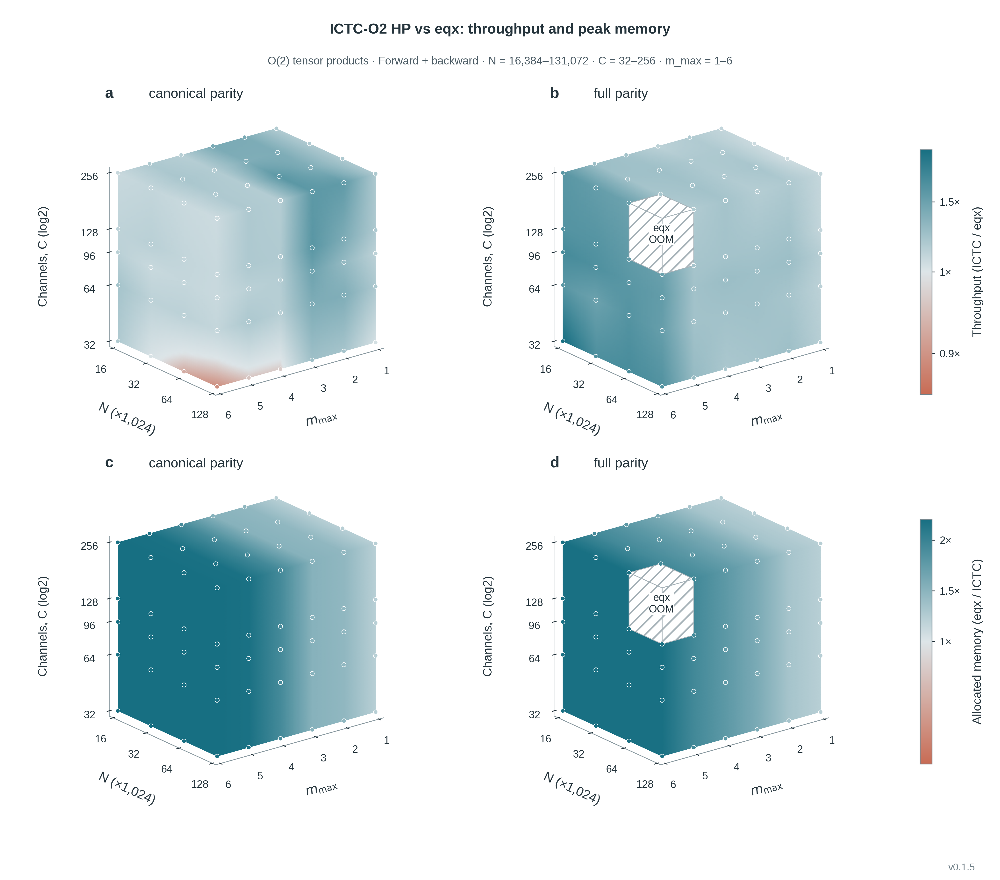
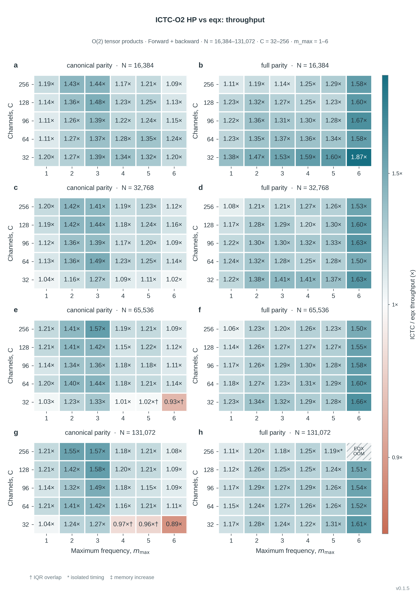
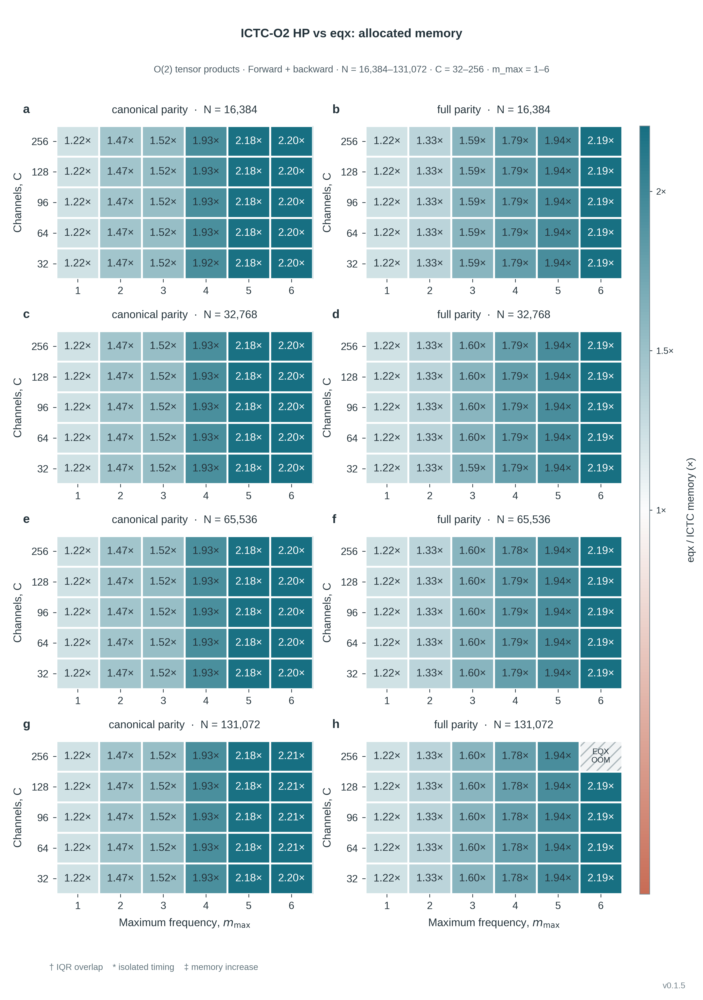

# ICTC-O2 HP vs eqx

ICTC-O2 HP **v0.1.5** 与 **EquivariantX（eqx）** 的完整吞吐量及显存比较。

| 扫描轴 | 已测范围 |
|---|---|
| N：张量积输入行数 | 16,384 / 32,768 / 65,536 / 131,072 |
| C：通道数 | 32 / 64 / 96 / 128 / 256 |
| m_max | 1–6 |
| parity | canonical parity / full parity |
| 操作 | forward / forward + full VJP |

240 个配置、480 项 ICTC 测量、479 项有效 eqx 测量和 60 组最大 N 数学参考校验。
吞吐量颜色倍率为 ICTC/eqx，显存颜色倍率为 eqx/ICTC；两者均以 1× 为中性，
大于 1× 表示 ICTC 更优。显存同时保留 allocated、reserved 和 sampled NVML。

## 结果与图

- [完整结果](results/complete_matrix.csv)、[汇总](results/summary.json)、[各阶结果](results/per_order.csv)。
- [显存统计](results/memory_accounting.csv)、[显存增加的配置](results/memory_increases.csv)、[慢于 eqx 的配置](results/slower_than_EQX.csv)。
- [原始测量及参考校验 JSON](results/raw/)、[导出核对](results/export_audit.json)。
- [脚本运行与完整重绘验证](results/reproduction_check.json)：远端作业 90920 / 90921 均通过。
- [最终图表入口](figures/INDEX.md)：全部 32 组 PNG / SVG / PDF 图及数据、说明、绘图审计。
- [测量口径](results/MEMORY_MEASUREMENT.md)、[复现依赖](requirements-qualified.txt)、[环境记录](runtime.json)。







479 个可比较的操作中，ICTC 的中位数快于 eqx 的有 455 个，慢于 eqx 的有 22 个，
相等的有 2 个。全部 239 个可比较 full VJP 的三种显存指标均更低。
eqx 在 N=131,072 / C256 / full parity / m_max=6 的独立进程 full VJP OOM，
对应倍率留空；m_max=5 的联合进程 OOM 使用双方成功的独立进程测量。

## 脚本

| 脚本 | 用途 |
|---|---|
| [benchmark.py](scripts/benchmark.py) | CUDA-event AB/BA 吞吐量；独立进程显存 |
| [run_scan.py](scripts/run_scan.py) | 最大 N 优先的完整扫描，每种表示对所有正 N 使用同一策略 |
| [validate_math.py](scripts/validate_math.py) | 全行、双输入梯度、全路径权重数学参考核对，以及 eqx 编译适配核对 |
| [eqx_adapter.py](scripts/eqx_adapter.py) | eqx parity/copy 路径和静态表示元数据适配 |
| [report_eqx.py](scripts/report_eqx.py) | 从当前原始记录汇总速度、显存、IQR 和 OOM |
| [render_figures.py](scripts/render_figures.py) | 最终二维热力图、连续 C 三维图及 PNG/SVG/PDF 输出 |
| [export_recorded_results.py](scripts/export_recorded_results.py) | 从原归档提取本次 eqx 数据，核对全部 480 行数值未变 |

这些脚本来自实际测量与最终绘图流程，仅整理了输入/输出目录并移除旧 ICTC 对照版本。
布局准备在计时前完成；full VJP 包含前向、双输入和所有路径权重的梯度。
eqx 编译适配只将表示元数据静态化，张量运算保持原样。双方原生布局、路径、
scalar/copy 约定和梯度均完整保留；权重保持可训练。

## 远端复现

eqx 使用外部 [xvzemin/tace](https://github.com/xvzemin/tace) 中的 `eqx.o2.TensorProduct`，
固定提交 `ac3aed47f5b35d49f1f237912150f0d9dd759ae7`；其源码不打包进本库。
需先准备该提交的外部 checkout 和已记录的 Linux / A100 环境。
所有数值运行、数据汇总和绘图都通过 `sbatch`，分区 `GPU-A100`、节点 `XHPC-A100`。

在远端设置三个绝对路径：

```bash
export PROJECT_ROOT=/path/to/ICTC-O2-HP
export O2_UPSTREAM_ROOT=/path/to/pinned-tace-checkout
export O2HP_RUN_ROOT=/public/home/sps-xia/rxlin/<新的任务目录>
mkdir -p "$O2HP_RUN_ROOT/logs"
```

完整扫描使用数组任务，每个任务处理一个 C，最多同时使用两张 GPU。
执行前应确认 eqx checkout 位于上述固定提交；默认 Python 为已验证的 mff 环境。

```bash
sbatch --chdir "$O2HP_RUN_ROOT" \
  --output "$O2HP_RUN_ROOT/logs/%x_%A_%a.log" \
  "$PROJECT_ROOT/benchmarks/eqx/slurm/scan.sbatch"
```

扫描结束后依次提交 [report.sbatch](slurm/report.sbatch) 和 [render.sbatch](slurm/render.sbatch)，
同样指定 `--chdir` 和任务目录中的 `--output`。也可直接从仓库已记录的数据重绘：

```bash
export O2HP_RAW_ROOT="$PROJECT_ROOT/benchmarks/eqx/results/raw"
sbatch --chdir "$O2HP_RUN_ROOT" \
  --output "$O2HP_RUN_ROOT/logs/%x_%j.log" \
  "$PROJECT_ROOT/benchmarks/eqx/slurm/render.sbatch"
```

新输出、日志和编译缓存写入任务目录。仓库内结果是已完成的固定数据，不由复现脚本覆盖。
原始记录保留实际作业号、源码路径和运行状态；CSV 中的 `raw/...` 指向仓库结果目录。
历史版本、无关 API 测试和旧绘图草稿仍留在独立归档中。
