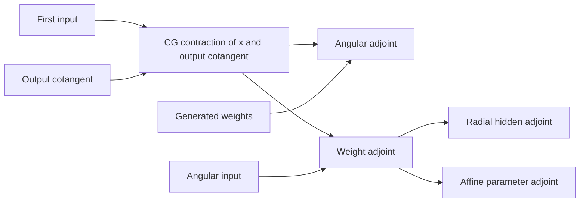

# Radial-chain adjoint scheduling

The implementation uses the requested gradient graph to select derivative
work, and shares Cartesian coupling expressions between TP adjoints. All
parameters, paths, coefficients and normalization remain unchanged.

## Requested derivative roles

Forward `requires_grad` flags indicate which derivatives are possible. An
individual `autograd.grad` call can request a smaller target graph. Eager
execution queries that active graph; compilation, proxy/functorch contexts
and unsupported engine queries retain all declared derivatives.

The TP backward uses three roles: left input, angular input and path weights.
The radial wrapper uses five: left, angular, hidden features, final affine
matrix and bias. It allocates and evaluates only requested roles. Hidden and
affine derivatives share the weight adjoint. A backward that needs neither
TP-input gradient skips recomputing the affine-generated edge weights.

Second derivatives retain the original multilinear identities, but each term
evaluates only its requested partial derivatives. Forward contractions are
needed only when the upstream output cotangent itself needs a derivative.
Live cotangents, geometry Hessians and parameter gradients remain supported;
requesting a geometry Hessian selects the additional geometry work.

For an energy/force loss, the first energy derivative may target geometry only.
It can skip feature and affine-parameter adjoints at that stage. The following
force-loss derivative still computes every requested parameter gradient,
including dependencies through those same features and affine parameters.
No parameter is frozen to select these roles.

## Shared coupling expressions

For external V=1 weights and C1–256, joint TP adjoints group paths by first
representation entry. The angular and path-weight adjoints reuse the same
contraction of first-input features with the output cotangent. The left
adjoint is written directly, with one writer per entry. Small partial angular
buffers are reduced over first entries; no atomics are needed.

For m=6, full first/output parity and canonical angular parity, the complete
TP VJP uses fourteen joint launches and one partial reduction. The preceding
implementation used one left-adjoint launch, seven angular launches and
fourteen weight-adjoint launches. Counts describe kernel scheduling; whole
chain speed and peak VRAM must be measured separately.

Joint adjoints keep a local weight block and its adjoint live together.
All channel counts use ordinary radial blocks of at most 8192 rows and a
2 GiB weight budget. The first saved block uses the same fixed 9/8 expansion,
at most 9216 rows and 2.25 GiB, to reduce affine recomputation. Backward consumes
that exact cached prefix, then ordinary blocks. Both caps depend on path/channel
size and use the same formulas for every total N. The joint kernel uses
`BU=nextpow2(C)` and `B=max(1,128//BU)`; this changes its work tile while
preserving the same input, output, weight and adjoint layouts for all channels.
Shared weights, other second-input multiplicities and other channel ranges
retain the preceding TP adjoint kernels, with requested-role pruning.

## Affine adjoint layout

For every channel count, hidden and affine adjoints use the same transposed GEMMs:
`gr = (alpha.T @ gw.T).T` and `ga = (radial.T @ gw).T`. Their output orientation
changes the cuBLAS kernel choice while preserving FP32 arithmetic, every path
and parameter. The affine accumulator matches the block results' physical
layout and is converted to the original contiguous `(weight_numel,H)` layout
once after all blocks. Hidden block results are copied into their final buffer.
The same layout policy applies to every N and every C.

Compiled blocks have separate cached entry points for each TP plan and
derivative role. This avoids exhausting one function's specialization limit
when callers use different derivative targets. It does not change an
execution algorithm according to atom or edge count.

## Direct TP writeback

The radial wrapper allocates the final output and requested input-adjoint
buffers once. Each block passes its final output slice to the TP forward,
and final left/angular gradient slices to the TP backward. Internal Triton
operations declare those destinations as mutated. The joint angular reduction
also writes into its final slice. This removes intermediate TP output and
input-adjoint staging without changing the raw kernel arithmetic.

The existing allocation-returning uvu operations share the same launch helpers
and retain their interfaces and derivative registrations. Mutating operations
run within the radial custom operations' no-grad implementation; their explicit
first/second derivative formulas stay intact. Hidden/affine GEMM layouts,
parameter accumulation and explicit first/second derivative formulas are retained.
Every C and N follows this writeback policy. Measured whole-chain speed and
allocated/reserved peaks are recorded in [performance](RADIAL_PERFORMANCE.md).

The qualified outer-AOT double-backward limitation and force-loss execution
mode remain as documented in [radial usage](RADIAL.md). Numerical and
performance evidence is maintained in the separate local benchmark archive.
